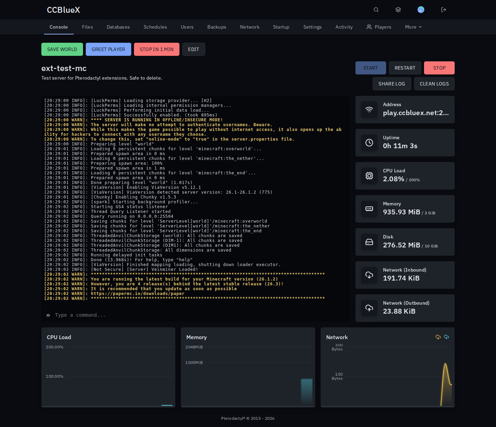
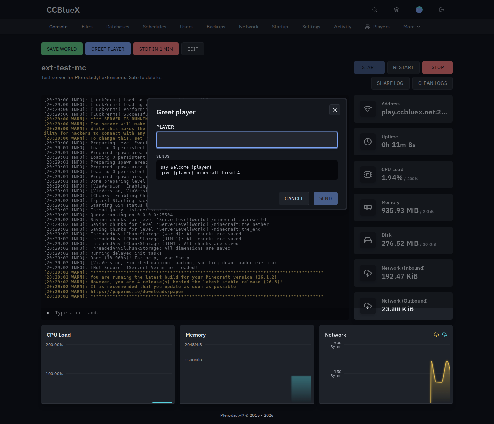

# Quick Commands for Pterodactyl

One-click buttons above the console for the commands you send every day. Works with every game.

## Install

1. Download `quick-commands-<version>.pteroext` from the [latest release](https://github.com/CCBlueX/Pterodactyl-Extension-Quick-Commands/releases/latest).
2. Install and enable it under **Admin → Extensions**.
3. Add buttons under **Admin → Quick Commands**, or with **Edit** above a server's console.

## Features

- **Buttons for everyone**: admin buttons show on every server or only on the eggs you pick.
- **Buttons per server**: owners and subusers with the **Quick Commands** permission add their own.
- **Several commands**: up to 10 per button, sent in order.
- **Ask first**: `{player}` or any `{name}` asks for a value before sending, with an optional confirmation.
- **Safe**: needs the console permission to use, and values cannot add commands of their own.

